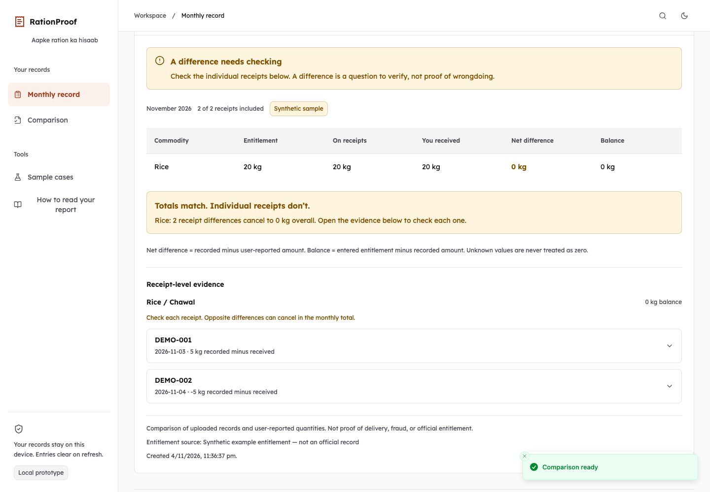
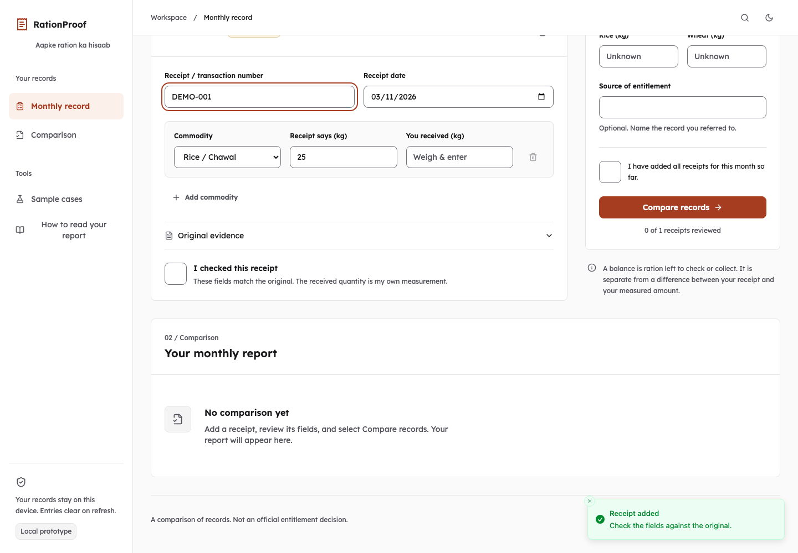

# RationProof

**Aapke ration ka saaf hisaab.** Compare what your ration receipts record with what you measured receiving, and keep each difference linked to its source.

A matching monthly total can hide two conflicting receipt entries. RationProof keeps those differences visible, separates an uncollected balance from a delivery difference, and leaves missing measurements unknown. It is a local prototype for a household or community volunteer; real-world usefulness has not yet been validated with users.

## The 30-second demonstration



Open **Sample cases → Load offsetting case**. Two synthetic receipts each record 10 kg. The entered measurements are 5 kg and 15 kg. Both monthly totals are 20 kg, but the report still flags the two receipt differences. Expand the evidence, then download the report as JSON.

All four sample cases use the actual Python comparison endpoint. Synthetic data is labelled in the interface and export. No saved result substitutes for a failed API call.

## Run locally

Requires **Python 3.11+**, **Node.js 20+ and npm**. Initial setup needs access to the package registries. No account, API key, `.env` file or cloud model is required.

```sh
git clone https://github.com/rajsingh1301/rationproof.git
cd rationproof
bash scripts/setup.sh
bash scripts/run.sh
```

Open **http://127.0.0.1:8765** and keep that Terminal window open. Stop with Ctrl+C. In an existing checkout, run the last two commands from the project folder. On macOS, `Start RationProof.command` is a Finder launcher after setup.

Setup creates an isolated Python environment for a new checkout, checks installed versions against `requirements.txt`, installs locked frontend packages and builds the browser app. Existing environments are reused after the version check. The two TanStack tarballs under `vendor/` are locked package dependencies included for reproducibility.

**If the page does not load:** run `bash scripts/run.sh` in your normal Terminal and inspect the error. If the error is `address already in use`, inspect the existing process before starting another instance. If assets are missing, run `npm ci && npm run build`.

### Image reading (on-device, optional)

On macOS, Python calls Apple's pretrained Vision text recognizer through PyObjC (`app/vision_ocr.py`). The PyObjC packages are pinned in `requirements.txt` and installed by setup on macOS only; no Swift or compiled helper is needed. Each read runs in a separate Python process with a 30-second timeout. An installed `tesseract` executable with English language data is another local reader; if Vision fails, Python tries Tesseract when available. No document is silently sent to an external API.



```sh
.venv/bin/python scripts/doctor.py
.venv/bin/python scripts/doctor.py --ocr
```

The second command performs **actual image recognition** on the labelled synthetic fixture and returns a failing exit code unless it suggests receipt `DEMO-001`, date `2026-11-03` and rice 25 kg. On 4 November 2026 it passed on the author's Mac (macOS 26.5.2) using Apple Vision via PyObjC. That is one synthetic image, not a measure of accuracy on real receipts. The UI distinguishes an installed/unverified reader from the latest successful or failed read.

Use **Paste text**, a UTF-8 `.txt` receipt, or **Enter manually** to use the comparison workflow independently. The downloadable sample text is a separate fixture, not a replacement OCR result.

## Workflow

1. Add a PNG/JPG/WebP image, UTF-8 text file, pasted text, or manual receipt. Images are limited to 8 MB and 16 megapixels.
2. Check the suggested transaction number, ISO date, commodity and quantity against the original. Enter the amount you measured; the app never copies the receipt amount into “received.”
3. Confirm each receipt, select the transaction month and enter the entitlement from your official record. Leave unknown amounts blank. Mark whether all receipts so far are included.
4. Compare records. Duplicate, conflicting, unreviewed and out-of-month entries are explained. Partial collection leaves a balance; opposite receipt differences remain visible.
5. Download JSON containing the report, reviewed inputs and source text, or print/save PDF. Entries clear on refresh. Loading a sample or clearing a populated record asks before replacing it.

## Architecture

```mermaid
flowchart LR
    U[Receipt image / text / manual entry] --> UI[React + TypeScript workspace]
    UI -->|image, temporary file| OCR[Python OCR orchestration]
    OCR --> V[Apple Vision via PyObjC, or Tesseract]
    V --> P[Conservative Python field parser]
    UI -->|pasted or uploaded text| P
    P --> R[Unconfirmed suggestions + source text]
    R --> H[Human review + measured quantity]
    UI -->|manual fields| H
    H --> A[FastAPI / Pydantic validation]
    A --> D[Decimal comparisons + duplicate / month rules]
    D --> E[Receipt evidence + monthly report]
    E --> J[Explicit JSON download / print]
```



The ML component is pretrained OCR. Field parsing and arithmetic are deterministic Python; this is not a newly trained model or an LLM guessing weights. The OCR call, field parsing, validation and arithmetic are all Python; on macOS, PyObjC exposes Apple's on-device Vision model to Python. The frontend uses React, Vite, Tailwind, Radix primitives, React Hook Form/Zod, TanStack Table and a chart loaded on demand. Light/dark tokens use zinc, one terracotta accent, an 8px radius and locally bundled Lexend 400/600.

| Code | Responsibility |
| --- | --- |
| `app/extraction.py` | Local readers, temporary-image cleanup, conservative field suggestions |
| `app/vision_ocr.py` | Apple Vision text recognition from Python (PyObjC), reading-order sort |
| `app/domain.py` | Validated decimal quantities, duplicate/month filtering, per-receipt arithmetic |
| `app/main.py` | FastAPI routes, local page and nonce-based content security policy |
| `frontend/workspace-app.tsx` | Review workspace, cancellable requests, sample replacement |
| `frontend/components/` | Receipt forms, monthly context, report, dialogs and shared primitives |
| `scripts/doctor.py` | Dependencies, built assets, text API and optional actual image check |

## Verification and measured results

```sh
npm run check
.venv/bin/python -m unittest discover -s tests -v
.venv/bin/python scripts/evaluate.py
.venv/bin/python scripts/doctor.py
```

Current checks: **46 Python tests**, **7 frontend regression tests**, lint, typecheck and production build pass. Python tests include the actual in-process text → review → comparison HTTP flow. OCR fallback/cleanup tests use mocked subprocesses and do not establish recognition accuracy.

The [recorded evaluation](docs/evaluation.json) contains **22 curated synthetic text cases / 23 labelled fields**. The parser produced 8 correct suggestions and 15 correct abstentions, with no unsafe suggestions on these cases. An illustrative “first quantity on the line” baseline produced 14 unsafe suggestions. These cases informed development: they are **not held-out data, an OCR benchmark, or evidence of field accuracy on real receipts**. See [verification details](docs/VERIFICATION.md).

Optional browser check, with a running server and an existing Playwright + matching Chromium installation:

```sh
node scripts/browser_check.cjs
# Add the actual image check only when a local reader is available:
RATIONPROOF_CHECK_OCR=1 node scripts/browser_check.cjs
```

Set `RATIONPROOF_PLAYWRIGHT` to the absolute package directory if Playwright is installed elsewhere. No browser dependency is needed to run the app. Screenshots go to ignored `artifacts/`; curated ones are in `docs/screenshots/`. On 4 November 2026 the full suite, including `RATIONPROOF_CHECK_OCR=1`, **passed** against the running server with Playwright 1.63.0 and its Chromium. Its first real run found two bugs, now fixed: a checkbox that moved out from under the pointer after a validation error, and a CSP violation from Zod's `eval` probe. A person has not yet reviewed print output or every mobile width by eye.

For frontend development, keep FastAPI running and use `npm run dev -- --open` in a second terminal. The Vite proxy forwards local API calls. Rebuild before testing the FastAPI-served production page.

## Privacy and limits

Application uploads are not written to a persistent ledger, logs or browser storage. Temporary OCR images are removed after processing; the operating system may maintain its own OCR caches. Browser memory holds current entries and image previews. Only the optional theme preference uses localStorage. Exported reports intentionally contain source text and reviewed inputs.

- Initial commodities: rice and wheat, kilograms with up to three decimals. The parser expects one explicit unit-bearing quantity per commodity line and ISO dates. Ambiguous labels, signs, repeated commodities and unsupported precision require manual entry.
- Hindi commodity aliases and Devanagari digits work in the **text parser**. Hindi image OCR, arbitrary receipt layouts and PDF ingestion are unverified or unsupported.
- Month filtering uses the transaction date. Allocation-month arrears and entitlement document extraction are future work.
- Exact transaction/date and document hashes identify many duplicates. Missing or wrong IDs across different images can evade detection.
- Entitlement and received weights are user-entered. Reports do not authenticate receipts, verify official entitlement, independently measure grain or prove fraud.
- Loopback-only development server, no production hosting or multi-user authentication. Not ready for handling public uploads on an exposed server.
- Real beneficiary accuracy, interviews, time saved and household impact remain unmeasured.

## Hackathon material and provenance

- [Audit and remaining priorities](docs/AUDIT.md)
- [2–3 minute demo script](docs/DEMO.md)
- [Five-slide pitch outline](docs/PITCH.md)
- [Development history](DEVELOPMENT_LOG.md) and [project instructions](PROJECT_INSTRUCTIONS.md)

Target: Neural Storm, proposed Human Impact track. The recorded listing places the build window at **2–4 November 2026, 20:00 IST**. Initial code and the first improvements were made **1 November, before the event**. The 4 November changes (Python OCR, two UI fixes and an ID parsing fix) are listed separately in the [development log](DEVELOPMENT_LOG.md). Pre-event eligibility remains an organizer question. Preserve the actual Git history and disclose existing work; no eligibility or “world first” claim is made. Image OCR has passed on one synthetic fixture on the author's Mac; real receipt accuracy is unmeasured.

**AI assistance:** OpenAI Codex assisted with implementation, review, documentation and tests (1 November). Claude Code (Anthropic) assisted with the 4 November OCR migration, bug fixes, verification and documentation. No independent user study or organizer approval is implied.
